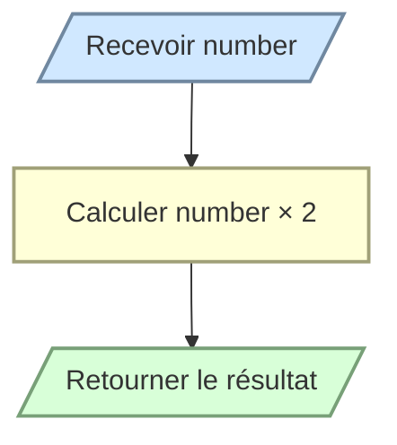

# Doubler un nombre

Écrivez la fonction `double_number(number)` qui retourne le double du nombre reçu.

```python
double_number(5)    # 10
double_number(-2.5) # -5
```

La fonction doit retourner le résultat sans l’afficher.


