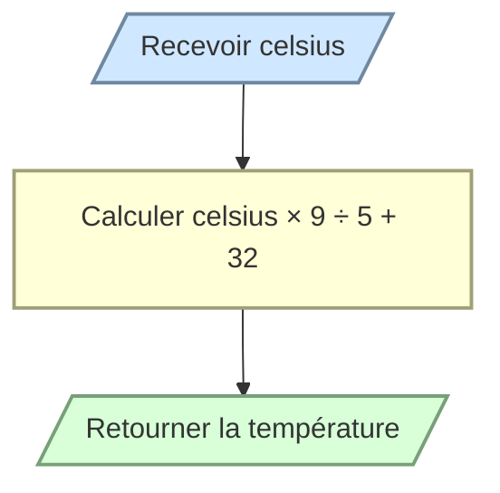

# Convertir une température

Écrivez `celsius_to_fahrenheit(celsius)` qui convertit une température Celsius en Fahrenheit.

Utilisez la formule :

$$F = C \times \frac{9}{5} + 32$$

```python
celsius_to_fahrenheit(0)   # 32
celsius_to_fahrenheit(100) # 212
```


