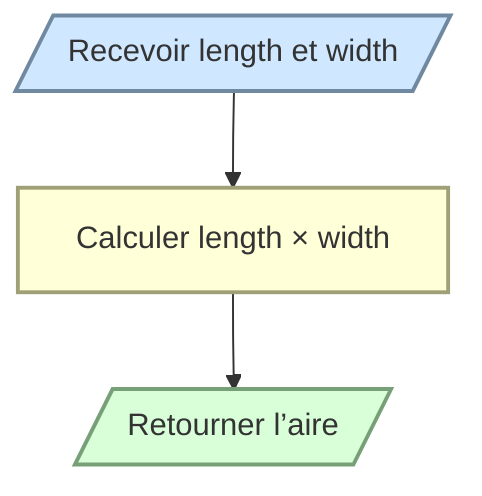

# Calculer l’aire d’un rectangle

Écrivez `rectangle_area(length, width)` qui retourne l’aire du rectangle.

L’aire est égale à `length × width`. Aucune validation particulière des dimensions n’est demandée.

```python
rectangle_area(5, 3)   # 15
rectangle_area(2.5, 4) # 10
```


