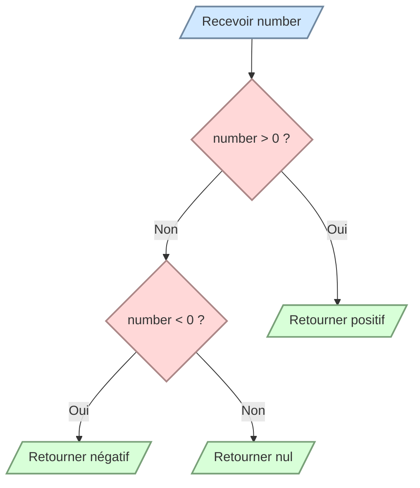

# Déterminer le signe d’un nombre

Écrivez `number_sign(number)` qui retourne exactement :

- `"positif"` si le nombre est supérieur à zéro ;
- `"négatif"` s’il est inférieur à zéro ;
- `"nul"` s’il vaut zéro.

