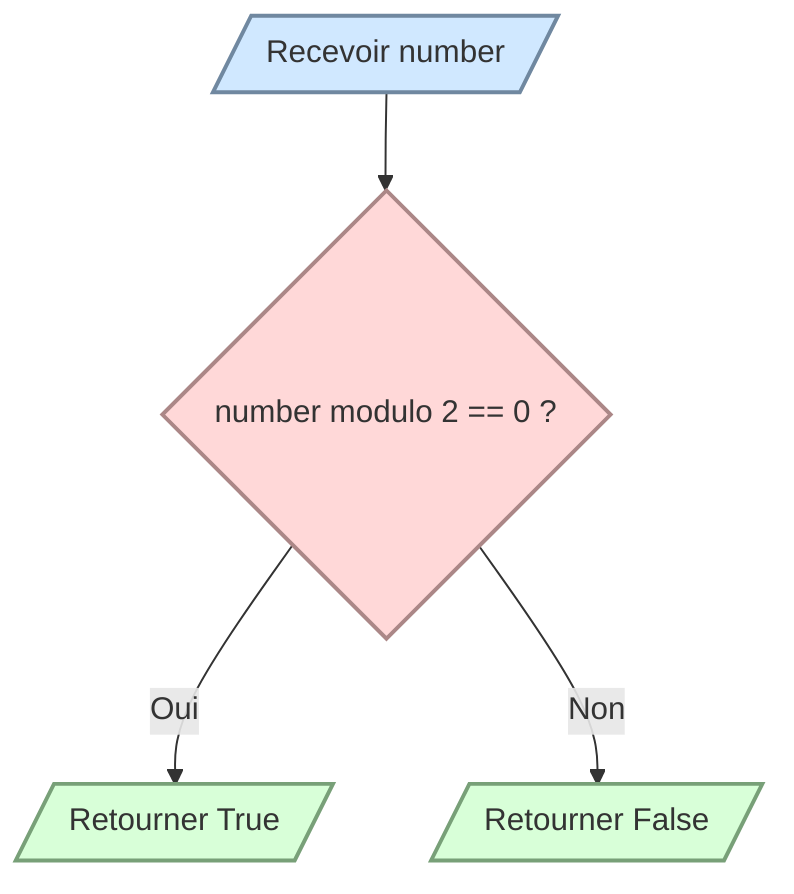

# Déterminer si un nombre est pair

Écrivez `is_even(number)` qui retourne un booléen :

- `True` si `number` est pair ;
- `False` sinon.

Utilisez l’opérateur modulo `%`. Les nombres négatifs doivent également fonctionner.

