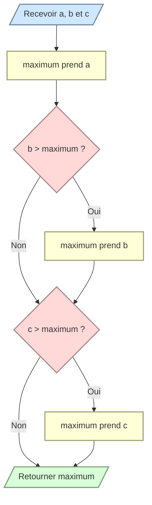

# Trouver le maximum de trois nombres

Écrivez `maximum_of_three(a, b, c)` qui retourne le plus grand des trois nombres.

N’utilisez pas la fonction intégrée `max()` et gérez correctement les valeurs égales.

