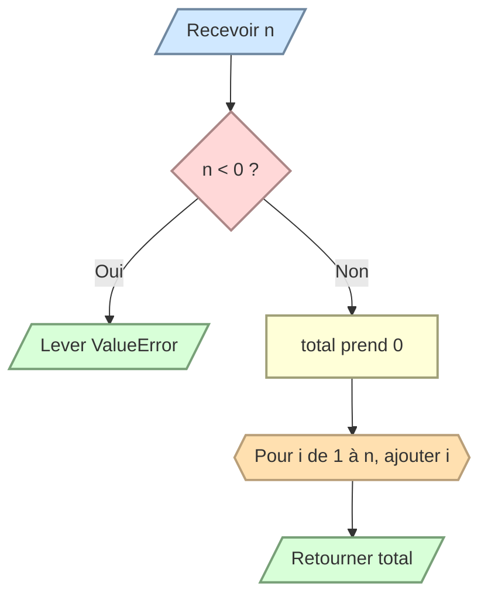

# Calculer la somme de 1 à n

Écrivez `sum_to_n(n)` qui retourne la somme des entiers de `1` à `n` inclus.

- Pour `n = 0`, retournez `0`.
- Pour un nombre négatif, levez `ValueError`.
- Utilisez une boucle, sans formule directe.

```python
sum_to_n(5) # 15
```


