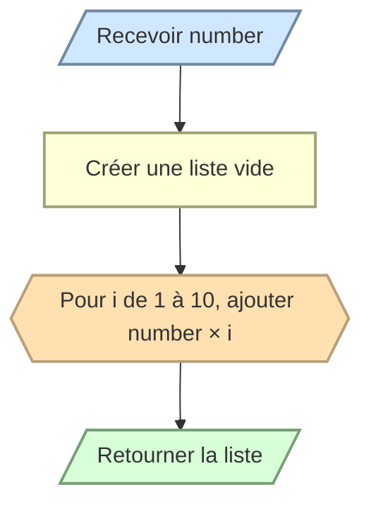

# Construire une table de multiplication

Écrivez `multiplication_table(number)` qui retourne une liste contenant les dix premiers multiples de `number`.

```python
multiplication_table(3)
# [3, 6, 9, 12, 15, 18, 21, 24, 27, 30]
```

La fonction doit retourner la liste et ne doit pas l’afficher.


