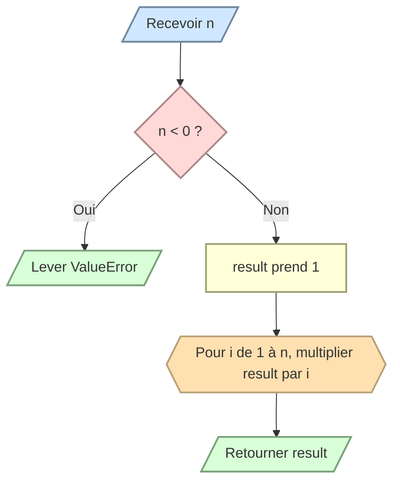

# Calculer une factorielle

Écrivez `factorial(n)` qui retourne la factorielle de l’entier `n`.

```text
5! = 5 × 4 × 3 × 2 × 1 = 120
0! = 1
```

Levez `ValueError` si `n` est négatif et utilisez une boucle.


