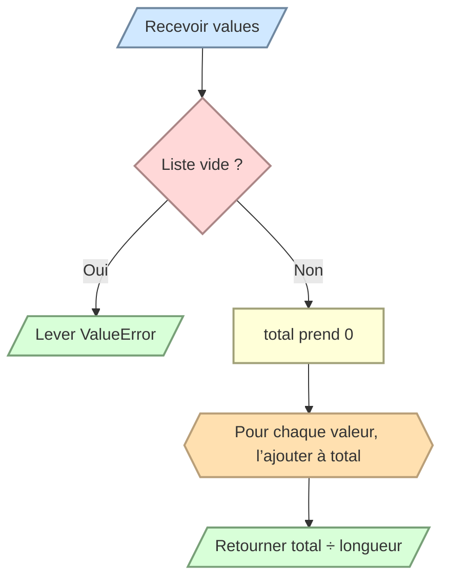

# Calculer une moyenne

Écrivez `average(values)` qui retourne la moyenne arithmétique des nombres de la liste.

- N’utilisez pas `sum()`.
- Pour une liste vide, levez `ValueError`.
- Retournez le résultat sans l’afficher.

```python
average([10, 12, 14]) # 12
average([-2, 2])      # 0
```


