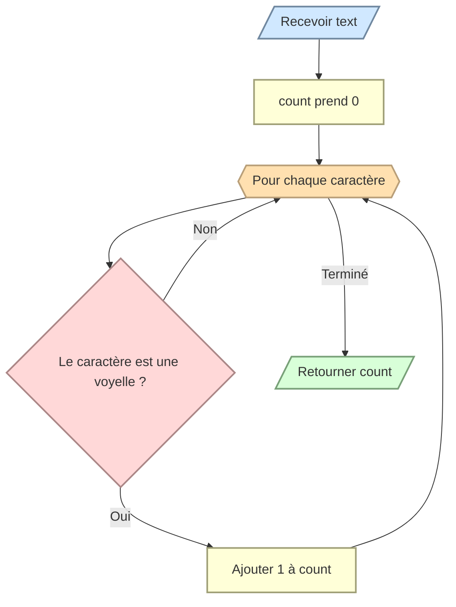

# Compter les voyelles

Écrivez `count_vowels(text)` qui retourne le nombre de voyelles présentes dans `text`.

Les voyelles utilisées sont `a`, `e`, `i`, `o`, `u` et `y`. Ignorez la différence entre majuscules et minuscules.

```python
count_vowels("bonjour") # 3
count_vowels("PYTHON")  # 2
```


