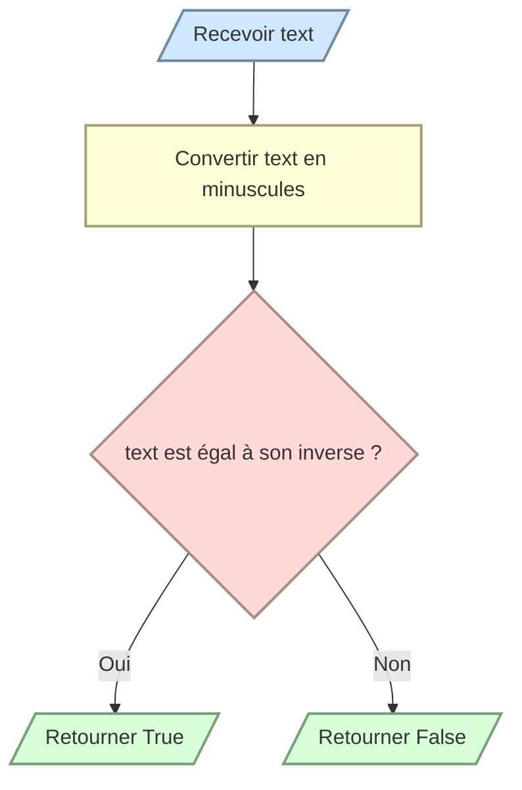

# Vérifier un palindrome

Un palindrome se lit de la même manière de gauche à droite et de droite à gauche.

Écrivez `is_palindrome(text)` qui retourne `True` ou `False` en ignorant la casse. Une chaîne vide est considérée comme un palindrome.

```python
is_palindrome("Radar")  # True
is_palindrome("Python") # False
```


